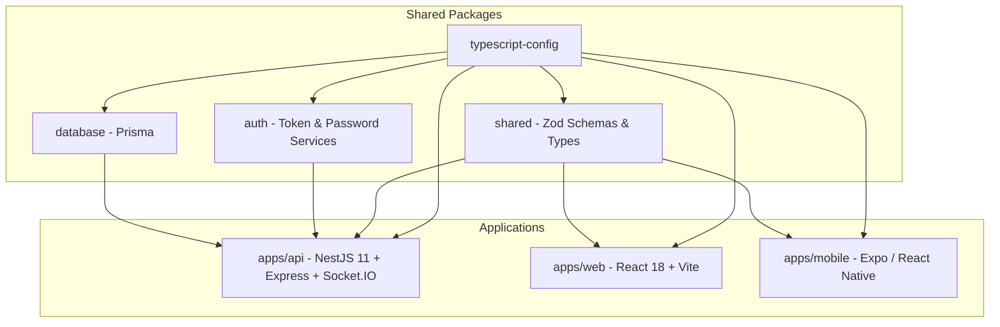
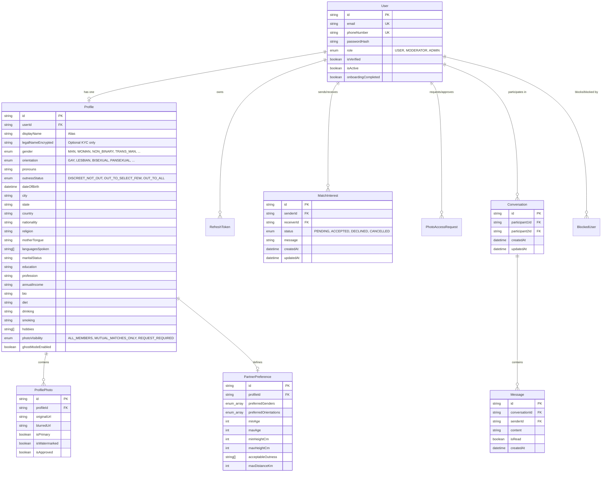
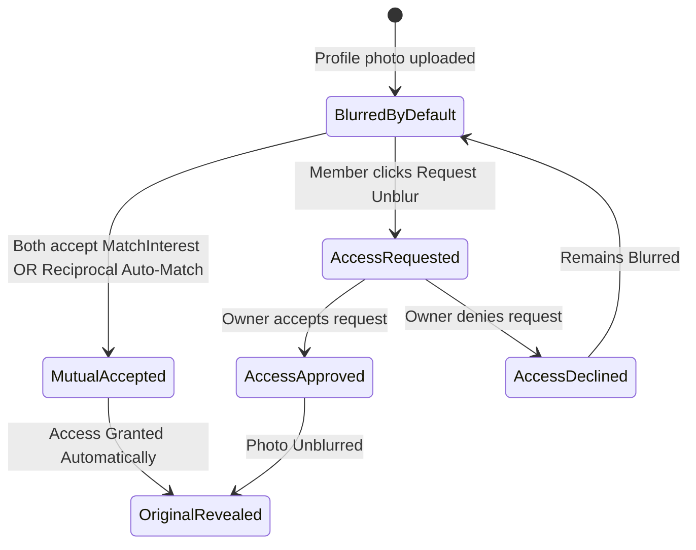

# EverPride System Architecture & Design Documentation

## 1. Executive Summary & Core Constraints

EverPride is an LGBTQ+ matrimonial and matchmaking platform. Unlike conventional dating apps or public matrimonial networks, EverPride operates under strict privacy and safety constraints:
1. **Zero Public Indexing:** Profiles cannot be crawled by search engines or viewed without authenticated verification.
2. **Identity Decoupling:** Users may live in discreet or non-affirming environments; their public-facing display alias is strictly isolated from legal verification documents (KYC).
3. **Progressive Photo Disclosure:** Profile photos are masked/blurred by default, revealed only upon mutual interest acceptance or explicitly granted unblur permission.
4. **Discreet Operation:** Ghost Mode allows safe usage without leaving digital footprints.
5. **Mutual Consent Communication:** In-app chat communication is strictly gated behind mutual interest acceptance or reciprocal auto-matching.

---

## 2. Monorepo Structural Topology

The platform uses a **Turborepo** + **pnpm** monorepo to maintain strong type boundaries while sharing validation schemas across backend, web, and mobile clients:

---

## 3. Data Model & Entity Relationship (ERD)

The database runs on **PostgreSQL 16** managed via **Prisma ORM** (`packages/database`).

---

## 4. Privacy & Access Control State Machine

### 4.1 Photo Privacy Matrix
When a user visits the discovery feed or opens a profile:

| Photo Visibility Setting | Requester Status | Result |
| :--- | :--- | :--- |
| `ALL_MEMBERS` | Any authenticated member | Original photo returned (watermarked) |
| `MUTUAL_MATCHES_ONLY` | Mutual interest `ACCEPTED` | Original photo returned |
| `MUTUAL_MATCHES_ONLY` | Interest `PENDING` or none | Blurred photo + Unblur Request CTA |
| `REQUEST_REQUIRED` | PhotoAccessRequest `ACCEPTED` | Original photo returned |
| `REQUEST_REQUIRED` | No access granted | Blurred photo + Unblur Request CTA |

---

## 5. Security & Real-Time Architecture

1. **Password Storage:** Uses `bcrypt` with 12 salt rounds (`packages/auth/PasswordService`).
2. **Token Strategy:**
   * Short-lived Access JWT: `15 minutes`.
   * Refresh JWT: `7 days`, stored securely in HTTP-only cookies or encrypted local storage.
3. **Screenshot & Exfiltration Protection:**
   * Profile photos are served with dynamic watermarking ("EverPride Verified").
   * Mobile app integrates `FLAG_SECURE` / screen capture blocking on profile albums.
4. **WebSocket Real-Time Gateway (`/chat`):**
   * Instant messaging and presence updates delivered over Socket.IO.
   * Personal user channels (`user:{id}`) receive instant notifications for new interests, interest acceptances, and mutual matches.
5. **Reciprocal Match Engine:**
   * When user A sends an interest to user B, the system checks if user B has already sent an interest to user A.
   * If yes, the engine automatically upgrades both interests to `ACCEPTED`, initializes the shared `Conversation` entity, and dispatches real-time `new_match` events to both users.
